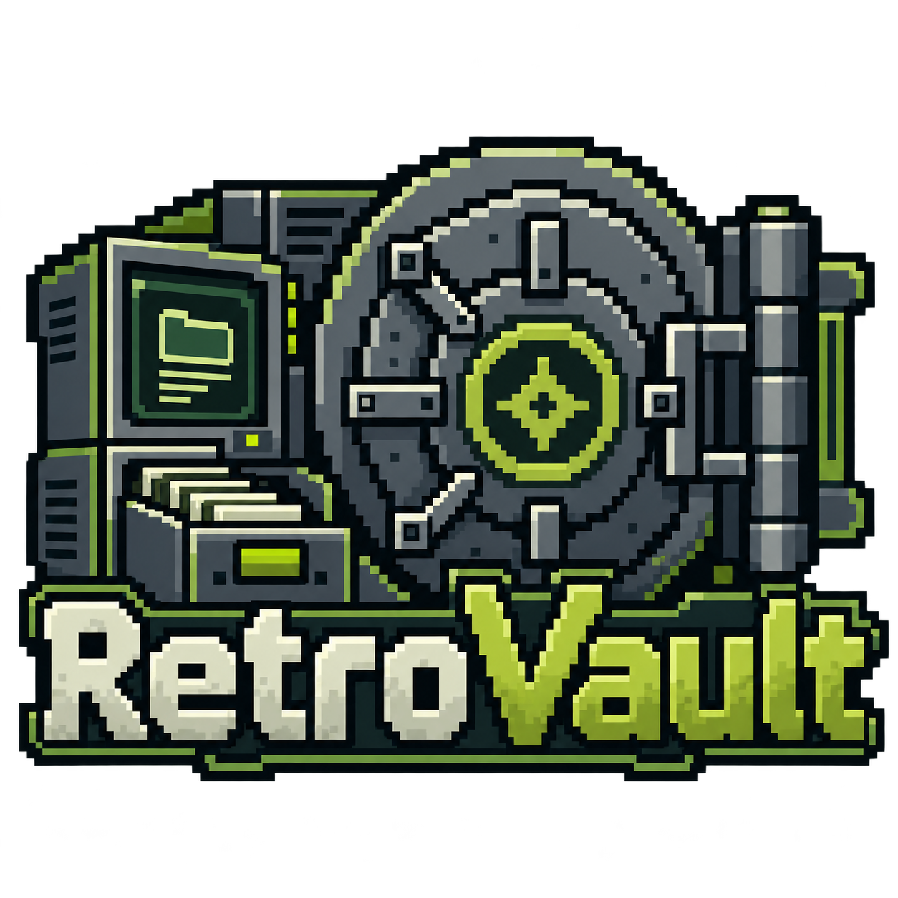
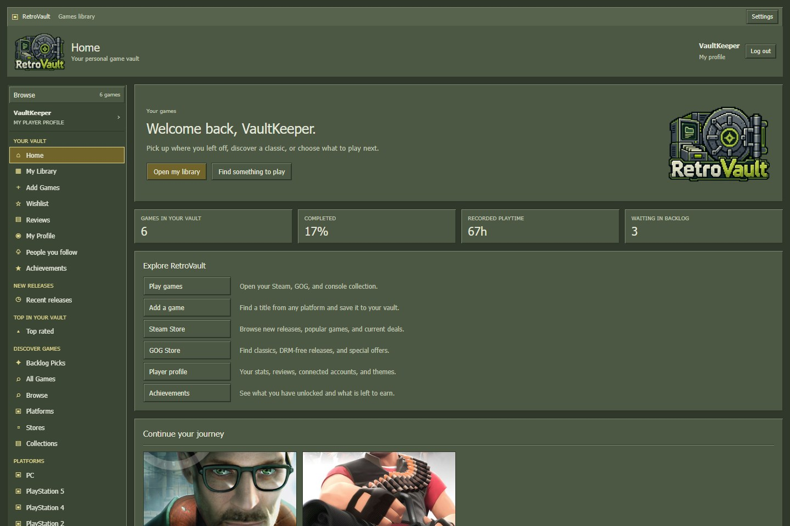
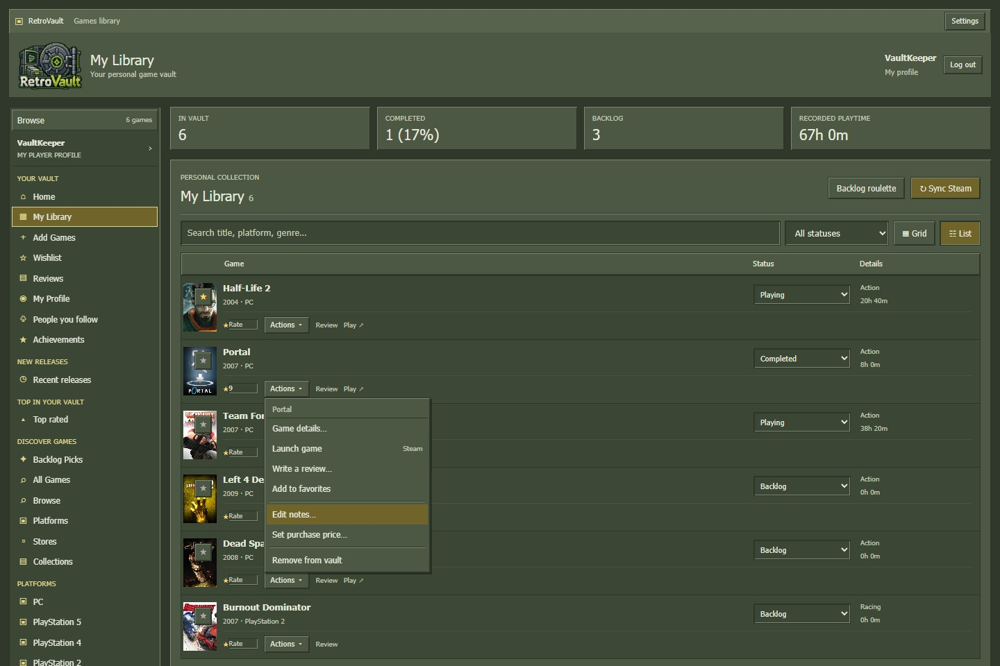
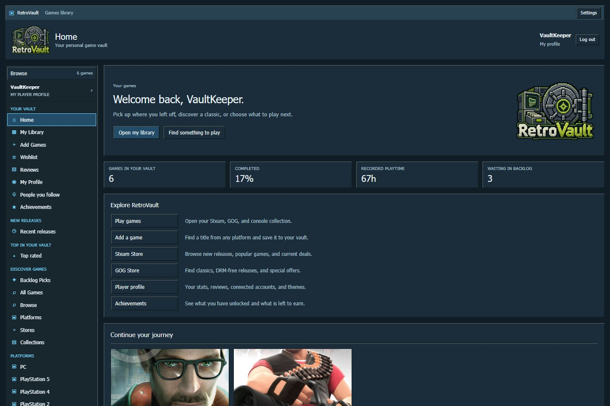

<p align="center">
  
</p>

<h1 align="center">RetroVault</h1>

<p align="center">
  <strong>Your games. Your story.</strong><br />
  Steam, GOG, and your console classics in one personal game vault.<br />
  Built with the square edges, olive panels, and beveled controls of early Steam.
</p>

<p align="center">
  <a href="https://retrovault-eta.vercel.app"></a>
  
  
  
</p>

<p align="center">
  <a href="https://retrovault-eta.vercel.app"><strong>Open RetroVault</strong></a> ·
  <a href="docs/user-guide.md">Player guide</a> ·
  <a href="docs/development.md">Run it yourself</a> ·
  <a href="https://github.com/smasher421/retrovault/issues/new/choose">Bugs & ideas</a>
</p>



*Interface previews use a simulated library. Game artwork belongs to its respective owners.*

## A home for your whole collection

Keep track of what you own, what you are playing, and what you want to try next. Sync Steam and GOG, add a PlayStation 2 favorite or a Nintendo classic, and give every game a place in your backlog.

| Build your vault | Find your next game | Make it yours |
| --- | --- | --- |
| Steam library and playtime sync | Platform and genre discovery | Nine collection statuses and favorites |
| GOG linking and library import | Steam and GOG storefronts with prices | Personal ratings, reviews, and notes |
| Manual entries for console and PC games | Game details, scores, artwork, and screenshots | Profile statistics and opt-in sharing |
| Search suggestions that fill in game details | Smart collections and filtered backlog roulette | Ten Valve-inspired skins and custom colors |

### More than a list of titles

- **A library you can navigate.** Combine title, genre, tags, platform, playtime, ratings and advanced discovery filters; save named searches to your account. Switch between list and grid, with 24 games per page. [Library filtering guide](docs/library-filters.md).
- **A backlog with a plan.** Track priority, campaign progress, completion estimates, personal tags and compatibility. Smart collections surface short games, hidden gems and forgotten picks; roulette respects every active filter across all pages.
- **Game information first.** Open a game to see its description, platforms, release details, available Metacritic/RAWG scores, and images. Screenshots open inside RetroVault with keyboard navigation.
- **Reviews with room to breathe.** Write your own review, or read English Steam reviews and RetroVault community reviews. Filters, sorting, five-review pages, and expandable text keep long reviews manageable.
- **Progress beyond playtime.** Browse unlocked and remaining Steam achievements, plus RetroAchievements progress for supported classics when the host has configured that integration.
- **A profile that reflects your collection.** See completion, favorite genres and platforms, most-played games, your reviews, connected accounts, and recent playtime activity.

<table>
  <tr>
    <td width="50%"></td>
    <td width="50%"></td>
  </tr>
  <tr>
    <td align="center">A familiar library and game menu</td>
    <td align="center">The same interface, a different atmosphere</td>
  </tr>
</table>

## Your first five minutes

1. **[Open RetroVault](https://retrovault-eta.vercel.app)** and choose **Sign in through Steam**. Steam handles sign-in; enter your Steam credentials only on Steam's own page.
2. **Open My Library → Sync Steam.** Steam's **Game details** must be public for the import. Your existing statuses, reviews, ratings, notes, and favorites survive subsequent syncs.
3. **Add a game from another platform.** Open **Add Games**, search for a title such as *Burnout Dominator*, select a suggestion, choose the edition/platform you own, and save it to your vault. Missing title? Add it manually.
4. **Make a backlog pick.** Mark games as Backlog, Playing, Completed, 100% Completed, or Abandoned. Use **Actions > Planning & progress** for priorities and estimates, or **Backlog roulette** for a choice matching your active filters.
5. **Visit My Profile.** Add a bio, browse your stats, choose a skin, and optionally connect GOG. The RetroVault logo always takes you Home.

You do not need your own API keys to use the hosted site. Separate installations need server-side configuration; see the [developer guide](docs/development.md).

### What each integration does

| Source | Available in RetroVault | Keep in mind |
| --- | --- | --- |
| **Steam** | Sign-in, owned games, playtime, achievements, store shelves, prices, and English reviews | Library and achievement access depend on Steam privacy settings and game support. |
| **GOG** | Store discovery, account linking, owned games, artwork, and available Galaxy playtime | Linking uses a manual success-URL handoff. Keep RetroVault open while the resumable import runs. |
| **Console / manual entries** | Catalog search, platform selection, collection status, artwork where available, ratings, and reviews | Adding a title does not automatically import console ownership or playtime. |
| **RetroAchievements** | Supported retro game completion and individual unlocks | Uses a RetroAchievements username and a server-configured API key. |

## The classic client, with your colors

Square frames. Recessed fields. Compact Tahoma text. Mustard selection rows in the default VGUI Olive skin. On phones, **Browse** expands the grouped navigation and closes after you select a page.

There are ten skins: **VGUI Olive**, **Source Obsidian**, **HEV Hazard**, **LAN Party 98**, **Aperture After Hours**, **RED Industries**, **BLU Engineering**, **Safe Room**, **Dust & Steel**, and **Ancient Ember**. Choose one in My Profile or Settings. Custom background, panel, accent, and text colors apply across the interface; **Use theme colors** restores the selected preset.

## Privacy and current limits

- **Your RetroVault profile starts private.** Sharing is opt-in through **My Profile → Profile visibility & sharing**. Public collections, review visibility, and completion badges follow that setting. This is separate from Steam's Game details setting.
- **Store prices currently use Romania as the region.** Prices, currencies, discounts, and availability come from the stores and may change. Purchases happen on the original store.
- **GOG support depends on its desktop interfaces.** This is not an officially registered GOG integration; provider changes can affect linking or sync. Some games have no available Galaxy playtime.
- **Discovery is still growing.** Platform/genre recommendations use the cached catalog and a curated GameDB selection; search reaches further. Metadata, scores, and artwork are not available for every release.
- **Automatic tracking has provider limits.** Manually added console games do not gain playtime tracking, and RetroAchievements does not cover every classic. Steam and GOG editions remain separate entries with separate playtime.

See the [player guide](docs/user-guide.md) for GOG linking, achievements, review filters, sharing, and common fixes.

## For developers

**React 19 · Vite 8 · Express 5 · Node.js 24 · Supabase Postgres · Vercel**

```sh
git clone https://github.com/smasher421/retrovault.git
cd retrovault
npm ci
```

Then copy [`.env.example`](.env.example) to `.env`, configure your own server credentials, apply the [database migrations](supabase/migrations) in order, and start both services:

```sh
npm run dev:all
```

Open the Vite URL printed in the terminal. The API uses port 3001 by default. Keep service-role keys and provider secrets on the server.

The **[developer guide](docs/development.md)** contains the complete setup, environment variables, architecture, data model, API reference, npm commands, and Vercel deployment instructions. Development-only coding agent tools are documented [separately](docs/agent-skills.md).

## Help shape the vault

Found a bug or have a feature idea? [Open an issue](https://github.com/smasher421/retrovault/issues/new/choose). For catalog or artwork problems, include the exact game title, release year, and platform so different editions can be distinguished. See [CONTRIBUTING.md](CONTRIBUTING.md) for useful report details and contribution guidance.

## Credits

Game data and media come from **Steam**, **GOG**, **[LizardByte GameDB](https://github.com/LizardByte/GameDB)** (based on IGDB data), **[RAWG](https://rawg.io/)**, **[SteamGridDB](https://www.steamgriddb.com/)**, and **[RetroAchievements](https://retroachievements.org/)**, depending on the entry and configured providers. The vault logo was supplied for RetroVault.

RetroVault is an independent fan project. The Valve-inspired skins are fan-made palettes; game names, artwork, and store branding belong to their respective owners.
