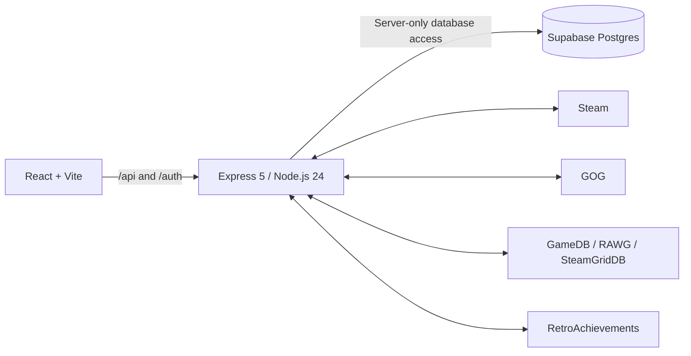

# Developer guide

[← Project overview](../README.md) · [Player guide](user-guide.md)

RetroVault uses React 19, Vite 8, Express 5, Node.js 24, and Supabase Postgres. This guide covers local setup, provider configuration, database migrations, API routes, and Vercel hosting. You need your own server-side credentials when running a separate instance.

[Local setup](#run-locally) · [Environment variables](#environment-variables) · [API reference](#api-routes) · [Deployment](#production-deployment)

## Architecture



The browser never receives the Supabase service-role key. Steam IDs from signed sessions are the account IDs; RetroVault does not use Supabase Auth. Every private collection query is scoped by the verified Steam ID in Express. The new tables have RLS enabled and grant Data API access only to `service_role`.

## Data model

Migration `20261015202324` copies existing `public.games` records into the normalized schema and leaves the legacy table available as a rollback/reference source.

| Table | Purpose |
| --- | --- |
| `public.profiles` | Steam identity, avatar, profile URL, theme settings and public/private preference. Public sharing is off by default. |
| `public.games_catalog` | Shared game metadata keyed by Steam, IGDB, legacy, or manual catalog keys; includes title, release details, genres, artwork, co-op flags and catalog rating rollups. |
| `public.user_games` | Per-player status, rating, platform, playtime, last played time, favorite, notes, review and purchase price. A player can have a title once. |
| `public.play_logs` | Positive playtime deltas linked to a player's collection entry and catalog title. A unique total-playtime constraint makes repeated syncs idempotent. |
| `public.games` | Original schema retained with its existing data; the current application writes to the normalized tables above. |
| `public.gog_connections` | Private per-player GOG identity, encrypted OAuth tokens, connection/sync dates and sync summary. Accessible only to the server service role. |

Migration `20261016134051_profile_themes_gog.sql` adds `profiles.bio`, the six new theme IDs, `games_catalog.gog_product_id`, the `gog` collection/activity source, and GOG sync provenance. Its service-only `sync_gog_library` function writes one batch atomically, locks by player, preserves personal fields, and records positive playtime deltas only after an initial baseline. Steam and GOG editions have distinct catalog keys, so their account playtimes are not combined into one edition.

The rating trigger recalculates a catalog game's average and rating count when a user changes their rating. The `pg_trgm` extension and title index support catalog title search. GameDB's searchable title buckets and per-game records provide the external cross-platform catalog; discovery filters a curated selection of popular games by platform and genre, then combines it with the shared RetroVault catalog. If a release is missing, search GameDB or add it manually.

GameDB publishes lightweight name-search buckets and per-game JSON records; RetroVault fetches a bucket during search and requests platform/game details as needed. The source data is based on IGDB and is credited in the Add Games and Discover screens alongside [LizardByte GameDB](https://github.com/LizardByte/GameDB).

## Run locally

### Requirements

- Node.js **24.x** and npm (see `engines` in `package.json`)
- A Supabase project
- A Steam Web API key for Steam profile details and library sync
- Steam **Game details** privacy set to **Public** so Steam returns owned games/playtime

### Setup

1. Clone the repository, enter the project directory, and install dependencies:

   ```sh
   git clone https://github.com/smasher421/retrovault.git
   cd retrovault
   npm ci
   ```

2. Copy [`.env.example`](../.env.example) to `.env` and enter server-side values. `.env` is ignored by Git. Keep every key server-only; do not add a `VITE_` prefix to secrets.

3. Run the migrations in order in the Supabase SQL Editor, if they have not already been run:

   - [`supabase/migrations/202610150001_retro_vault_games.sql`](../supabase/migrations/202610150001_retro_vault_games.sql)
   - [`supabase/migrations/202610150002_fix_steam_upsert_conflict_target.sql`](../supabase/migrations/202610150002_fix_steam_upsert_conflict_target.sql)
   - [`supabase/migrations/20261015202324_retrovault_2_catalog_profiles_play_logs.sql`](../supabase/migrations/20261015202324_retrovault_2_catalog_profiles_play_logs.sql)
   - [`supabase/migrations/20261015203007_service_role_rls_policies_and_revoke_public_event_function.sql`](../supabase/migrations/20261015203007_service_role_rls_policies_and_revoke_public_event_function.sql)
   - [`supabase/migrations/20261015203022_index_catalog_foreign_keys.sql`](../supabase/migrations/20261015203022_index_catalog_foreign_keys.sql)
   - [`supabase/migrations/20261015204001_add_game_details_and_artwork_fields.sql`](../supabase/migrations/20261015204001_add_game_details_and_artwork_fields.sql)
   - [`supabase/migrations/20261016134051_profile_themes_gog.sql`](../supabase/migrations/20261016134051_profile_themes_gog.sql)

   The original migrations preserve the legacy collection and introduce the normalized catalog, service-only RLS, indexes, and game artwork. The latest migration adds profile bios, Valve-inspired skins and private GOG account/sync storage.

4. Set Steam **Profile → Edit Profile → Privacy Settings → Game details** to **Public**.

5. Start the API and frontend together:

   ```sh
   npm run dev:all
   ```

6. Open the Vite URL printed in the terminal, sign in through Steam, then choose **Sync Steam**.

Vite proxies `/api/*` and `/auth/*` to Express on port `3001`. The frontend defaults to port `5173` and selects another free port if needed.

## Connecting GOG

1. Sign in to RetroVault through Steam and open **My Profile → Connected accounts → Connect GOG**.
2. Choose **Open secure GOG sign-in**. Enter credentials only on GOG's own page.
3. After login, GOG redirects to its `embed.gog.com/on_login_success` page. Copy the full address from that tab and paste it in RetroVault's **GOG success URL** field. The connection attempt expires after ten minutes.
4. **Connect & sync library** links the account and starts the first import. Subsequent imports use **Sync GOG library**; no new login is needed while the refresh token remains valid.

The web app uses a manual redirect handoff because the desktop GOG client redirects to GOG's domain, which RetroVault cannot read across browser origins. Account linking is bound to the current Steam session and a short-lived connection attempt. The server exchanges the one-time code, keeps AES-256-GCM-encrypted access/refresh tokens in `gog_connections`, and returns only account display fields. Tokens are bound to the owner through authenticated encryption. The encryption key derives from `GOG_TOKEN_SECRET`, or `SESSION_SECRET` when unset. Keep that secret stable; rotating it requires connecting GOG again.

GOG does not provide this as a registered, supported RetroVault OAuth integration. The desktop protocol is based on the primary implementation in [Heroic gogdl authentication](https://github.com/Heroic-Games-Launcher/heroic-gogdl/blob/main/gogdl/auth.py), [Heroic GOG library](https://github.com/Heroic-Games-Launcher/HeroicGamesLauncher/blob/main/src/backend/storeManagers/gog/library.ts), and [Heroic GOG game sessions](https://github.com/Heroic-Games-Launcher/HeroicGamesLauncher/blob/main/src/backend/storeManagers/gog/games.ts). These interfaces may change independently of RetroVault. A complete login/sync requires the player's interactive GOG sign-in.

### GOG data and sync behavior

- All Galaxy library pages are fetched; only owned GOG entries are imported. Other stores linked inside Galaxy are excluded. Products identified as DLC rather than games/packs are skipped.
- Product artwork, descriptions and screenshots come from GOG. Product metadata is reused for seven days; store offers cache for ten minutes. New store prices are never written into a player's historical purchase price.
- Playtime comes from Galaxy's `time_sum`, in minutes. Games never tracked by Galaxy, private data, and unavailable endpoints may have **Playtime unavailable**. Missing statistics do not erase a previously recorded total. Last-played time is used only when a returned session supplies a date.
- The initial total becomes a baseline, not a new lifetime-sized activity event. Later increases generate activity deltas. A partial failure reports counts and can be retried without duplicating collection entries.
- GOG sync checkpoints are stored in the private connection record. Each authenticated continuation request discovers one ownership page or imports up to six products, using a database compare-and-swap lease to prevent concurrent workers from processing the same batch. Keep RetroVault open while syncing; returning to the app resumes a pending sync after a restart or a different server instance. A failed request's lease expires after two minutes so it can be retried. Already imported batches remain saved.
- Disconnect removes saved GOG access, while imported games and reviews stay in the vault. Steam remains the login method. GOG names are shown in the private profile/header; the existing public-profile identity remains Steam.

### Additional GOG API routes

| Method | Route | Purpose |
| --- | --- | --- |
| GET | `/api/store/gog?category=bestsellers&page=1` | GOG shelves: `bestsellers`, `classics`, `new`, `deals`. |
| POST | `/api/store/gog/:id/catalog` | Cache a GOG game's metadata and return its dossier. |
| GET | `/api/accounts/gog` | Sanitized linked account and current sync progress. |
| POST | `/api/accounts/gog/start` | Create a connection attempt and return the official GOG login URL. |
| POST | `/api/accounts/gog/connect` | Exchange the pasted success URL with its connection state. |
| POST | `/api/accounts/gog/sync` | Start a resumable import; responds with current progress. |
| POST | `/api/accounts/gog/sync/continue` | Process the next ownership page or product batch of a pending import. |
| DELETE | `/api/accounts/gog` | Disconnect the account and remove saved tokens. |

All routes require the RetroVault session. Account/store mutations check the requesting origin. Vite preserves the browser Host header for these checks; deployed reverse proxies must preserve it too, or set `APP_URL` to the exact public origin.

## Environment variables

| Variable | Required | Purpose |
| --- | --- | --- |
| `SUPABASE_URL` | Yes | Supabase project URL used by the backend. |
| `SUPABASE_SERVICE_ROLE_KEY` | Yes | Server-only database key. Do not expose it to the browser or commit it. |
| `SESSION_SECRET` | Yes | Long random secret used to sign session cookies. |
| `GOG_TOKEN_SECRET` | Optional | Separate stable encryption secret for GOG tokens; defaults to a key derived from `SESSION_SECRET`. |
| `STEAM_API_KEY` | For profile details and library sync | Steam Web API key, used only by Express. Steam OpenID sign-in itself does not require this key. |
| `RETROACHIEVEMENTS_API_KEY` | Optional | RetroAchievements Web API key. Enables retro game achievement progress; keep it server-side in `.env`. |
| `RETROACHIEVEMENTS_USERNAME` | Optional | RetroAchievements username prefilled on the Achievements page. You can change it there. |
| `RAWG_API_KEY` | Optional | Enables RAWG cross-platform search and game details. Keep it server-side in `.env`; RetroVault displays RAWG attribution in catalog search and game details. |
| `STEAMGRIDDB_API_KEY` | Optional | Enables SteamGridDB grid, hero and logo artwork for Steam and non-Steam games. Keep it on the Express server. |
| `APP_URL` | Production | Public origin used to construct Steam's OpenID callback, e.g. `https://vault.example.com`. |
| `PORT` | Optional | Express port; defaults to `3001`. |
| `NODE_ENV` | Production | Set to `production` to use `Secure` cookies. |

`SUPABASE_URL` can alternatively be supplied as `VITE_SUPABASE_URL`, but only the URL is public; database writes still require the server-side service key. Never use `VITE_SUPABASE_SERVICE_ROLE_KEY`.

## API routes

Private routes require the signed Steam session cookie unless noted.

| Method | Route | Purpose |
| --- | --- | --- |
| `GET` | `/api/health` | Shows whether required server configuration is present; returns booleans, never secrets. |
| `GET` | `/auth/steam` | Starts Steam OpenID sign-in. |
| `GET` | `/auth/steam/callback` | Validates state and asks Steam to verify the OpenID assertion. |
| `GET` | `/api/auth/me` | Returns the current Steam identity and profile. |
| `POST` | `/api/auth/logout` | Clears the session cookie. |
| `GET` | `/api/games` | Lists the caller's collection joined with catalog metadata. |
| `GET` | `/api/achievements/steam/:steamAppId` | Returns the caller's earned and locked achievements for a Steam game in their synced collection. |
| `GET` | `/api/achievements/retro?username=...&count=100&offset=0` | Lists a RetroAchievements user's game completion progress. |
| `GET` | `/api/achievements/retro/:gameId?username=...` | Returns individual RetroAchievements unlocks and earned dates for a retro game. |
| `GET` | `/api/games/:id/details` | Loads cached details and lazily enriches a game in the caller's collection. |
| `POST` | `/api/games` | Adds a manual title. Accepts `title`, `platform`, `genre`/`genres`, `year`, `status`, `notes` and `cover_image`. |
| `PATCH` | `/api/games/:id` | Changes `status`, or updates `rating`, `is_favorite`, `notes`, `review_text`, `purchase_price` or `platform_played`. |
| `DELETE` | `/api/games/:id` | Removes the caller's collection entry. |
| `GET` | `/api/profile` | Reads the current player's settings. |
| `PATCH` | `/api/profile` | Updates `preferred_theme`, `custom_theme`, `bio` (up to 500 characters), or `is_public`. |
| `POST` | `/api/catalog/rawg/:rawgId` | Loads and saves RAWG game metadata and screenshots into the shared catalog. |
| `GET` | `/api/catalog/search?q=...` | Merges RetroVault, GameDB, and configured RAWG title suggestions. |
| `GET` | `/api/catalog/discover?platform=...&genre=...&page=...` | Recommends games by platform or genre while excluding titles already in the caller's library. |
| `GET` | `/api/reviews?limit=...` | Returns recent reviews from public profiles and the caller's own reviews. |
| `GET` | `/api/catalog/:catalogId/reviews?page=1&sort=recent&rating=all` | Five reviews per page, totals and page count. Sort: recent/highest/lowest. Rating: all/positive/mixed/negative/unrated. Visibility is enforced before paging. |
| `GET` | `/api/reviews/page?page=1&sort=recent&rating=all` | The same paged public/own review feed across games; optional `catalog_id` filter. |
| `GET` | `/api/catalog/:catalogId/details` | Loads details and artwork for a catalog game before it is added to a user's collection. |
| `GET` | `/api/store/steam?category=top_sellers\|most_played\|new_releases\|specials` | Returns the selected Steam storefront shelf, including Romanian prices and the current player chart. |
| `POST` | `/api/store/steam/:steamAppId/catalog` | Loads a Steam product into the shared catalog so it can be viewed or added to Backlog. |
| `GET` | `/api/steam/reviews/:steamAppId?sort=helpful&sentiment=all&cursor=*` | Five English Steam reviews per page through IUserReviewsService. Returns `next_cursor` and matching count; URL-encode the cursor for the next request. Sort: helpful/recent/updated; sentiment: all/positive/negative. Cached 15 minutes. |
| `GET` | `/api/steam/library` | Imports visible Steam games, writes playtime deltas and performs bounded Steam Store enrichment. |
| `GET` | `/api/activity?limit=100` | Lists recent playtime delta records. |
| `GET` | `/api/public/profiles/:steamId` | Public profile summary and collection; only available after the owner opts in. |
| `GET` | `/u/:steamId` | Frontend public profile page. |
| `GET` | `/api/badge/:steamId.svg` | Dynamic SVG completion badge for a public profile. |
| `GET` | `/api/lan-matches/:steamId` | Lists shared co-op/multiplayer games; the other profile must be public. |

## Security and privacy

- OpenID state is checked against a short-lived, HttpOnly cookie; the OpenID assertion is verified with Steam before a session is issued.
- User IDs are derived from the signed session, never from a request body or arbitrary account header.
- The service-role key stays in the Express process. RLS is enabled on the normalized tables, and `anon`/`authenticated` have no table grants.
- Public profiles are opt-in. A public profile route and badge return 404 when the owner is private.
- Steam game library visibility is controlled by Steam's Game details privacy setting; RetroVault cannot import a hidden library.

## Troubleshooting

- **Steam login cannot be verified:** Express needs outbound HTTPS access to `steamcommunity.com`; start both services through `npm run dev:all` and sign in from the Vite origin.
- **Sync returns no games:** check `STEAM_API_KEY`, make Steam Game details public, and restart Express after editing `.env`.
- **Supabase relation/table error:** apply every migration listed above in order. The client uses `profiles`, `games_catalog`, `user_games`, and `play_logs`; the server also uses the private `gog_connections` table.
- **Unique conflict target error:** migration 002 replaces the original partial index with the full `(user_id, steam_app_id)` index required by the legacy upsert path. The normalized 2.0 sync uses the catalog and user-collection constraints from migration 003.
- **Missing Steam covers:** Steam does not publish every artwork variant. RetroVault falls back to the backdrop when available and to a title initial otherwise.
- **Profile not visible:** the owner must enable public sharing in **Social**. Steam profile visibility and RetroVault's own public setting are separate.
- **LAN matcher shows no result:** both accounts need a collection entry for the same game, the game must be marked co-op or multiplayer in the catalog, and the other RetroVault profile must be public.

## Production deployment

[`vercel.json`](../vercel.json) and [`api/index.js`](../api/index.js) contain the deployment configuration. The Vercel production site is [retrovault-eta.vercel.app](https://retrovault-eta.vercel.app). `vercel.json` builds the Vite frontend and sends `/api/*` and `/auth/*` through the shared Express function in `api/index.js`; other frontend routes load the SPA. The function uses Node.js 24 with a 300-second maximum duration. Importing the app does not open a TCP listener; `npm run server` still starts the local API.

Set `APP_URL` to the canonical HTTPS domain in Vercel's **Production** environment so Steam OpenID returns to the same host that set its verification cookie. Use the canonical site URL when signing in. On Vercel, session and GOG connection-state cookies are `Secure`, `HttpOnly`, and `SameSite=Lax`. GOG connection state is an encrypted, user-bound cookie, so another server instance can validate the callback.

For your own deployment, configure `SUPABASE_URL`, `SUPABASE_SERVICE_ROLE_KEY`, `SESSION_SECRET`, and `STEAM_API_KEY` in your Vercel project, together with the optional RAWG, SteamGridDB, and RetroAchievements variables listed above. Set `APP_URL` to your own canonical HTTPS origin. Keep the session/encryption secret stable so saved GOG credentials remain readable. These are server variables; do not prefix secrets with `VITE_`. Local `.env` files are excluded from uploads by `.vercelignore`, and the local Vercel link is ignored by Git. Configure production environment values in Vercel before deploying; later changes require a redeployment.

From the project directory, authenticate using `npx vercel login`, run `npx vercel link` to select or create a project in your account, configure that project's environment, and deploy with `npx vercel --prod`. Do not copy another installation's `.vercel/project.json`. On another hosting provider, serve `dist/` and proxy `/api/*` and `/auth/*` to the Express process behind the same HTTPS origin. `npm run preview` previews the frontend only; it is not a replacement for the API.

The focused `npm run test:server` regression uses simulated providers and database responses to check GOG connection state across app instances, ownership pagination/deduplication, batch leases, partial failures, and the public response boundary. It does not log in to a real GOG account or change live data.

## NPM scripts

| Script | Action |
| --- | --- |
| `npm run dev` | Starts Vite. |
| `npm run server` | Starts Express on port 3001 by default. |
| `npm run dev:all` | Starts Vite and Express together. |
| `npm run build` | Builds the frontend into `dist/`. |
| `npm run preview` | Previews the Vite production build. |
| `npm run lint` | Runs ESLint. |
| `npm run test:server` | Runs the focused GOG regression suite with simulated providers and database responses. |

## Coding agent skills

The installed skills, pinned upstream sources, custom workflows, and CLI/authentication status are documented in [docs/agent-skills.md](agent-skills.md). Custom skill sources are maintained in [`tooling/skills/`](../tooling/skills/); they are development aids and are not shipped in the website bundle.
